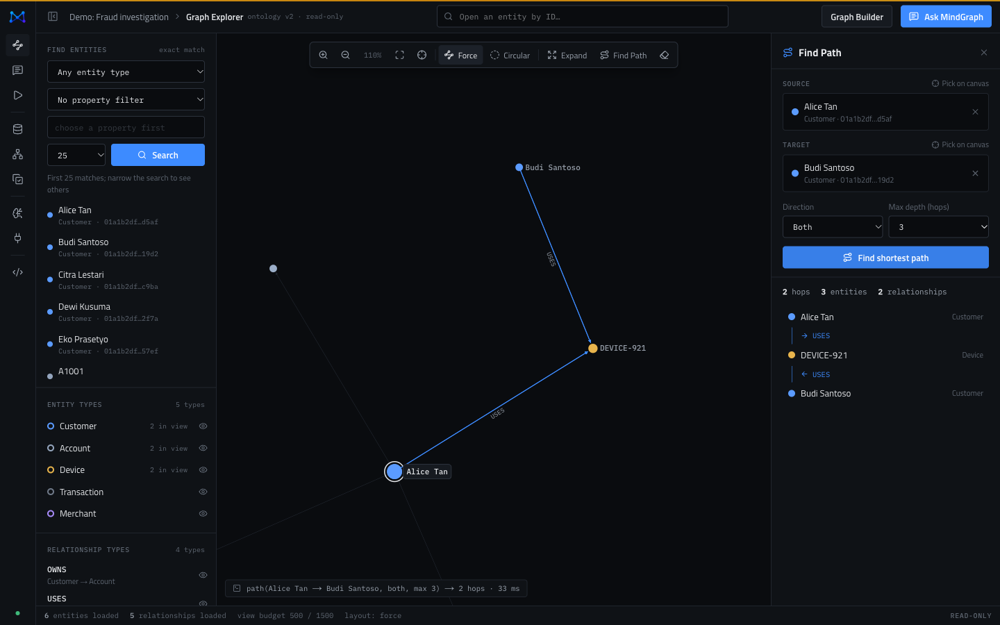
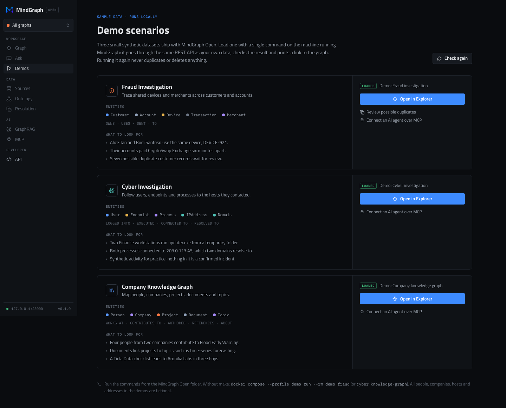
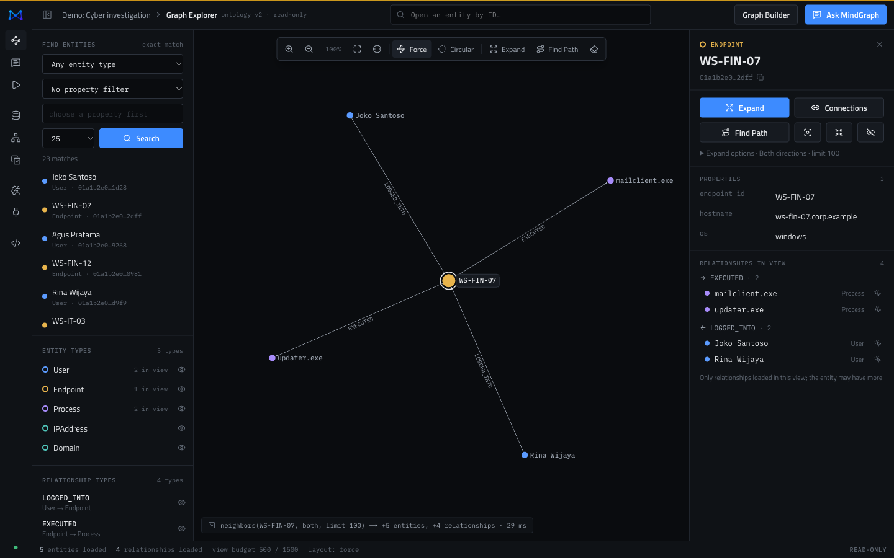
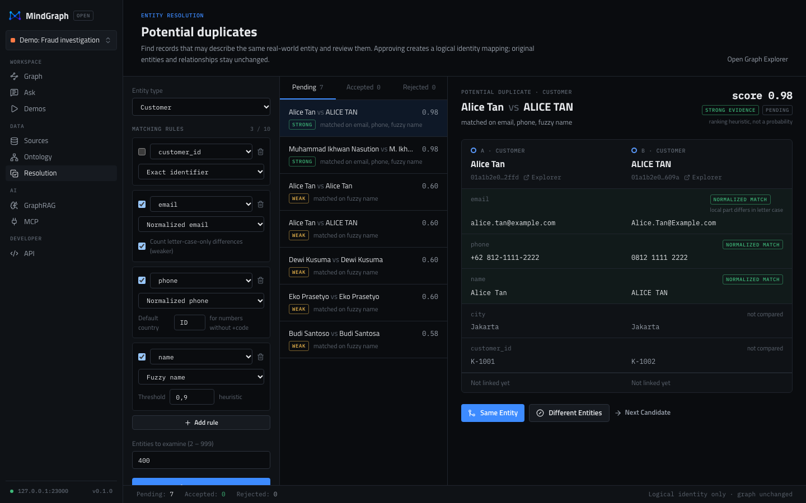
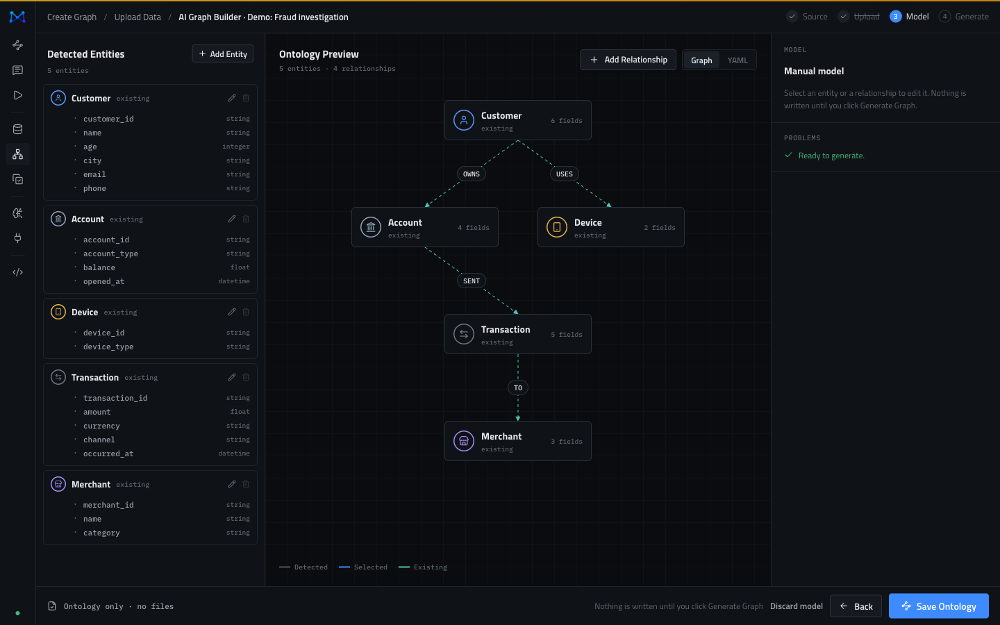

<p align="center">
  
</p>

<p align="center"><strong>Open-source Graph Intelligence for humans and AI agents.</strong></p>

<p align="center">
  <a href="https://github.com/mindwalker-ai/MindGraph-Open/actions/workflows/ci.yml"></a>
  
  
</p>

MindGraph-OSS turns structured data (CSV and JSON) into an explorable
knowledge graph. Investigate relationships visually, find hidden
connections, review duplicate records, ask questions that are answered from
graph evidence, and give your AI agents the same graph over MCP. It runs on
your machine with one command.

```text
Data → Graph → Explore → Ask → Investigate → Connect to AI agents
```



> **Status: alpha (v0.1.0-alpha.1 in preparation).** Usable for local
> exploration and evaluation. There is no authentication yet, so keep it on
> your machine. Interfaces may change. See the
> [known limitations](docs/release/KNOWN_LIMITATIONS.md).

## Quick start

You need Docker with Compose v2 (or Podman). Nothing else.

```bash
git clone https://github.com/mindwalker-ai/MindGraph-Open
cd MindGraph-Open
docker compose up -d --build      # first build takes a few minutes
make demo-fraud                   # load a demo graph, prints the Explorer link
```

Open **http://localhost:3000**. Full instructions, configuration, Podman
and troubleshooting: [Getting started](docs/getting-started/README.md).

## What you can do

| | |
|---|---|
| **Build a graph from files** | Upload CSV or JSON, review the inferred schema, define entity and relationship types, map columns and ingest. Deterministic, idempotent jobs; works without any AI. |
| **AI Graph Builder** (optional) | A model suggests the ontology and mappings across several files; Rust validates every suggestion and nothing is written until you approve it. Hosted or local models (OpenAI-compatible, e.g. Ollama). |
| **Graph Explorer** | Exact search, neighbourhood expansion, shortest paths (up to 6 hops), layouts and filters on a WebGL canvas. Read-only. |
| **Ask MindGraph** (optional) | Graph-first GraphRAG: questions are answered from retrieved entities, relationships and paths, with citations you can show on the graph. |
| **Entity resolution** | Find possible duplicates with explicit rules (email, phone, identifiers, fuzzy names), compare evidence and link records as one identity without merging or deleting data. |
| **MCP for AI agents** | A read-only MCP server (stdio) gives Claude Code, Codex, Cursor and other clients search, neighbours, paths and subgraphs over one graph. |
| **REST API** | Everything the UI does is a documented `/api/v1` call ([OpenAPI](docs/api/openapi.yaml)). |

## Demo scenarios

Each loads in one command through the public API and verifies itself.

| Scenario | Command | Story |
|---|---|---|
| [Fraud investigation](examples/fraud/README.md) | `make demo-fraud` | customers sharing a device, payments to the same merchants, near-duplicate KYC records |
| [Cyber investigation](examples/cyber/README.md) | `make demo-cyber` | users, endpoints, processes, connections and DNS from one synthetic day |
| [Company knowledge graph](examples/knowledge-graph/README.md) | `make demo-knowledge` | people, companies, projects, documents and topics across three organisations |

<table>
  <tr>
    <td></td>
    <td></td>
  </tr>
  <tr>
    <td></td>
    <td></td>
  </tr>
</table>

## How it works

> **Rust owns the graph platform. Python owns AI-specific intelligence.**

```text
        Next.js + TypeScript + Sigma.js / Graphology (WebGL)
                                  │  REST / SSE
                                  ▼
                 mindgraph-core  (Rust · Axum · Tokio)  ── modular monolith
                  │                    │                     │
                  ▼                    ▼                     ▼
          Apache HugeGraph        PostgreSQL           mindgraph-ai
            graph data          app metadata      (Python · FastAPI, internal, optional)

   AI agents ──stdio──► mindgraph-mcp ──REST (loopback)──► mindgraph-core
```

- AI only suggests and phrases; deterministic Rust code validates, retrieves
  and writes. Every manual flow works with no model configured.
- Only the web app (3000) and the Core API (8080) are published, on
  `127.0.0.1`. PostgreSQL, HugeGraph and the AI service stay internal.
- Logs never contain prompts, model output, property values or credentials.

Architecture decisions: [`docs/adr/`](docs/adr/). Crate map and storage
details: [`docs/architecture/`](docs/architecture/README.md).

## Documentation

| | |
|---|---|
| [Getting started](docs/getting-started/README.md) | install, demos, configuration, credentials, troubleshooting |
| [Tutorials](docs/tutorials/README.md) | the web app, the REST API, the AI Graph Builder, Ask MindGraph |
| [MCP](docs/mcp/README.md) · [Entity resolution](docs/entity-resolution/README.md) · [API](docs/api/README.md) | feature references |
| [Data and backups](docs/operations/backup-restore.md) | persistence, safe cleanup, backup and restore |
| [Development guide](docs/development/README.md) | building, testing, smoke and browser tests |
| [Release notes](docs/release/v0.1.0-alpha.1.md) · [Changelog](CHANGELOG.md) · [Known limitations](docs/release/KNOWN_LIMITATIONS.md) | what is in this release |
| [Benchmarks](docs/benchmarks/v0.1.0.md) | measured ingestion, query and resolution timings |

## Security

MindGraph-OSS v0.1 has **no authentication or authorisation**. Do not expose
it to the internet or an untrusted network. Report vulnerabilities privately
as described in [SECURITY.md](SECURITY.md).

## Roadmap

| Milestone | Scope | Status |
|---|---|---|
| M0–M3 | Repository, domain model, GraphStore (memory + HugeGraph), PostgreSQL metadata and project APIs | ✅ |
| M4 | Deterministic CSV / JSON ingestion | ✅ |
| M5 | AI Graph Builder | ✅ |
| M6 | Graph Explorer | ✅ |
| M7 | GraphRAG with evidence (Ask MindGraph) | ✅ |
| M8 | MCP server for AI agents | ✅ |
| M9 | Entity resolution with human review | ✅ |
| M10 | Launch hardening: demos, smoke and browser tests, audits, docs | ✅ (alpha candidate) |

## Contributing

Contributions are welcome. Read [CONTRIBUTING.md](CONTRIBUTING.md), follow
the [Code of Conduct](CODE_OF_CONDUCT.md), and see [SUPPORT.md](SUPPORT.md)
for where to ask questions.

## License

MindGraph-OSS is licensed under the [GNU AGPL-3.0](LICENSE). ADR-015 proposes
Apache-2.0 for the MCP package (`crates/mindgraph-mcp` already declares it),
SDKs and examples. That split is **pending legal approval**; the inventory
and open questions are in
[docs/legal/LICENSE_AUDIT.md](docs/legal/LICENSE_AUDIT.md).
