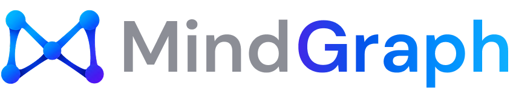

<p align="center">
  
</p>

<p align="center"><strong>Open-source Graph Intelligence for humans and AI agents.</strong></p>

MindGraph-OSS turns messy, structured data into an explorable knowledge graph.
You can then investigate relationships visually, ask questions with GraphRAG, and
connect your AI agents through MCP.

```text
Data → Graph → Explore → Ask → Investigate → Connect to AI Agents
```

> **Status: pre-alpha.** Milestones **M0** to **M8** are complete: graph
> storage, project APIs, dataset ingestion, the AI Graph Builder, the visual
> Graph Explorer, graph-first GraphRAG (Ask MindGraph) and a read-only MCP
> server for AI agents. Entity resolution arrives next. See the
> [roadmap](#roadmap).

---

## Quick start

The only requirement is Docker with Compose v2.

```bash
git clone https://github.com/mindwalker-ai/MindGraph-Open
cd MindGraph-Open
docker compose up --build
```

Then open **http://localhost:3000**, or talk to the API directly:

```bash
curl http://localhost:8080/health          # liveness
curl http://localhost:8080/ready           # PostgreSQL reachable?

curl -X POST http://localhost:8080/api/v1/graphs \
  -H "Content-Type: application/json" \
  -d '{"name": "Fraud Investigation", "description": "Demo graph"}'

curl http://localhost:8080/api/v1/graphs
curl http://localhost:8080/api/v1/graphs/<graph_id>/ontology
```

Graph projects are stored in PostgreSQL and survive restarts. Each new graph
starts with an empty, active ontology v1. (Port 8080 already taken? Set
`MINDGRAPH_CORE_PORT` in `.env`.) The full API is described in
[`docs/api/openapi.yaml`](docs/api/openapi.yaml).

### Build a graph in the browser (M5)

Open **http://localhost:3000**:

```text
Create a Graph    name it; start from CSV, JSON or an empty ontology
Upload Data       drop several files; each is parsed (rows, columns, headers)
AI Graph Builder  "Generate Graph Model": one model for all files, linked across
                  files by shared identifiers (or "Build manually")
                  review on a canvas: entity types, relationships, YAML view;
                  edit names, properties, source fields, modes and endpoints
Generate          saves the ontology, then ingests each file, creators first
```

The AI only *suggests*. The uploaded files, their analysis profiles and the
suggestion are stored as you go, but no ontology version and no graph data
are written until you click **Generate Graph**, which uses the same
endpoints as the curl examples below. When it finishes, **Explore Graph**
opens the result in the Graph Explorer. Screens of later milestones
(templates, the demo) are shown in the navigation but disabled until they
ship. Without an
AI provider the builder says so and the manual path works the same way. See
[Use the AI Graph Builder (M5)](#use-the-ai-graph-builder-m5) to configure a
model.

### Explore a graph (M6)

Open a graph with **Explore Graph** on its card on the home page (or on the
builder's success screen), or go to `/graphs/<graph_id>/explore`. The Graph
Explorer is a read-only investigation workspace:

```text
Find entities     exact search by entity type, property and value, or open
                  an entity by its ID (no full-text or fuzzy search)
Inspect           click an entity or relationship: typed properties and the
                  relationships loaded around it
Expand            double-click (or E) loads an entity's neighbours: both
                  directions or one, optionally one relationship type, at
                  most 100 relationships per expansion (up to 1,000)
Find Path         the shortest path between two entities, computed by
                  MindGraph Core within a maximum depth (1-6 hops), then
                  highlighted; "no path" only means none within that depth
Layouts and view  force-directed or circular layout, fit, zoom, hide entities
                  and types, reset; nothing here changes the stored graph
```

The canvas shows the subgraph loaded so far, never the whole graph: it starts
from one entity's neighbourhood and grows as you expand. The browser holds at
most 500 entities and 1,500 relationships; past that, the explorer says what
was left out and offers to unload hidden entities or reset the view. The
counts in the status bar are what is loaded, not totals of the graph.

### Ask MindGraph (M7)

In the Graph Explorer, click **Ask MindGraph** (or press A, or choose *Ask
about this entity* in an entity's context menu). The panel opens next to the
graph, which stays visible:

```text
Scope        "Selected · <entity>" (the most reliable) or "Whole graph
             (bounded)"; suggested questions follow the entity's type and
             the ontology
Answer       MindGraph Core retrieves evidence from the graph, then the
             model phrases an answer that cites it: [E1] entity, [R1]
             relationship, [P1] path
Show on      the evidence is merged into the canvas and highlighted in
Graph        orange; click a reference to focus that entity or path;
             "Clear Evidence Highlight" restores normal styling
Status       Answered · Partial (a retrieval limit was hit, results may be
             missing) · Insufficient evidence (the retrieved graph context
             does not support an answer)
Follow-up    ask again in the same panel: "Is there a path between them?",
             "What about C003?". The last 3 questions and the entities they
             cited go with it; evidence is retrieved afresh every time.
             "New conversation" (the clock icon) forgets them
```

For the fraud example, select Alice Tan and ask *"Who else shares this
device?"*: the evidence is Alice (C001), Budi Santoso (C002), `DEVICE-921`
and their two `USES` relationships. Ask MindGraph needs a configured model
(see [GraphRAG](#graphrag-ask-mindgraph-m7)); without one the panel says so
and exploring keeps working.

### Connect an AI agent over MCP (M8)

`mindgraph-mcp` gives Claude Code, Codex, Cursor or any MCP client
read-only tools over one graph:

```text
get_graph_info   get_graph_schema   search_entities   get_entity
get_neighbors    find_path          get_subgraph      ask_graph (opt-in, GraphRAG)
```

The client starts the binary over stdio, and the binary calls MindGraph
Core's REST API on `127.0.0.1`. It never touches PostgreSQL, HugeGraph or
the AI service. Build it, then copy your client's configuration from
**MCP** in the sidebar, which fills in the graph id:

```bash
cargo build -p mindgraph-mcp --release
claude mcp add --scope project mindgraph \
  --env MINDGRAPH_MCP_CORE_URL=http://127.0.0.1:8080 \
  --env MINDGRAPH_MCP_GRAPH_ID=<graph id> \
  -- "$PWD/target/release/mindgraph-mcp"
```

Then ask your agent *"Find Customer C001 and show its relationships."*.
The tools are deterministic and bounded, and search is exact, not
full-text. `ask_graph` stays off unless you enable it, because it sends
graph evidence to Core's model provider. See [`docs/mcp/`](docs/mcp/README.md)
for the tools, security and the [Claude Code](docs/mcp/claude-code.md),
[Codex](docs/mcp/codex.md) and [Cursor](docs/mcp/cursor.md) guides.

### Load a dataset without AI (M4)

The files in [`examples/fraud/`](examples/fraud/) build
`Customer ──OWNS──> Account` and `Customer ──USES──> Device` deterministically
(synthetic data). The commands use
[`jq`](https://jqlang.org) to read ids; without it, copy the ids by hand.
Nothing here needs Python or the AI service.

```bash
API=http://localhost:8080/api/v1

# 1. Create a graph and define its ontology (Customer, Account, OWNS).
GRAPH=$(curl -s -X POST $API/graphs -H "Content-Type: application/json" \
  -d '{"name": "Fraud demo"}' | jq -r .id)
curl -s -X POST $API/graphs/$GRAPH/ontology -H "Content-Type: application/json" \
  -d @examples/fraud/ontology.json | jq '{version, types: [.entity_types[].name]}'

# 2. Upload customers.csv and analyse it (an asynchronous job).
SOURCE=$(curl -s -F file=@examples/fraud/customers.csv $API/graphs/$GRAPH/data-sources | jq -r .id)
JOB=$(curl -s -X POST $API/graphs/$GRAPH/data-sources/$SOURCE/analyze | jq -r .job_id)
curl -s $API/jobs/$JOB | jq '{status, progress}'          # repeat until "completed"

# 3. Inspect the inferred schema.
curl -s $API/graphs/$GRAPH/data-sources/$SOURCE \
  | jq '.profile.fields[] | {name, inferred_type, nullable}'

# 4. Submit the mapping and watch the ingestion job (Server-Sent Events).
JOB=$(curl -s -X POST $API/graphs/$GRAPH/data-sources/$SOURCE/ingestions \
  -H "Content-Type: application/json" -H "Idempotency-Key: $(uuidgen)" \
  -d @examples/fraud/customers.mapping.json | jq -r .id)
curl -N $API/jobs/$JOB/events                              # ends with "event: completed"

# 5. Accounts: create Account entities, look up existing customers, link OWNS.
SOURCE=$(curl -s -F file=@examples/fraud/accounts.csv $API/graphs/$GRAPH/data-sources | jq -r .id)
JOB=$(curl -s -X POST $API/graphs/$GRAPH/data-sources/$SOURCE/analyze | jq -r .job_id)
sleep 1 && curl -s $API/jobs/$JOB | jq .status
JOB=$(curl -s -X POST $API/graphs/$GRAPH/data-sources/$SOURCE/ingestions \
  -H "Content-Type: application/json" -H "Idempotency-Key: $(uuidgen)" \
  -d @examples/fraud/accounts.mapping.json | jq -r .id)
sleep 1 && curl -s $API/jobs/$JOB | jq '{status, result}'
# → {"records_processed": 7, "entities_created": 7, "entities_matched": 5, "relationships_created": 7}

# 6. Devices: two customers share DEVICE-921 (Customer ─USES→ Device).
SOURCE=$(curl -s -F file=@examples/fraud/devices.csv $API/graphs/$GRAPH/data-sources | jq -r .id)
JOB=$(curl -s -X POST $API/graphs/$GRAPH/data-sources/$SOURCE/analyze | jq -r .job_id)
sleep 1 && curl -s $API/jobs/$JOB | jq .status
JOB=$(curl -s -X POST $API/graphs/$GRAPH/data-sources/$SOURCE/ingestions \
  -H "Content-Type: application/json" -H "Idempotency-Key: $(uuidgen)" \
  -d @examples/fraud/devices.mapping.json | jq -r .id)
sleep 1 && curl -s $API/jobs/$JOB | jq '{status, result}'
# → {"records_processed": 4, "entities_created": 3, "entities_matched": 3, "relationships_created": 4}
```

Then open `http://localhost:3000/graphs/$GRAPH/explore`: select Alice Tan,
expand her neighbourhood (her accounts through `OWNS`, her devices through
`USES`), and find the path to Budi Santoso, two hops through the shared
`DEVICE-921`. The same reads are available over the API:

```bash
ALICE=$(curl -s -X POST $API/graphs/$GRAPH/entities/search -H "Content-Type: application/json" \
  -d '{"entity_type": "Customer", "property_filters": {"customer_id": "C001"}}' | jq -r '.data[0].id')
BUDI=$(curl -s -X POST $API/graphs/$GRAPH/entities/search -H "Content-Type: application/json" \
  -d '{"entity_type": "Customer", "property_filters": {"customer_id": "C002"}}' | jq -r '.data[0].id')
curl -s "$API/graphs/$GRAPH/entities/$ALICE/neighbors?direction=outgoing&limit=100" \
  | jq '[.relationships[].relationship_type]'                   # → ["OWNS", "OWNS", "USES", "USES"]
curl -s -X POST $API/graphs/$GRAPH/paths -H "Content-Type: application/json" \
  -d "{\"source_id\": \"$ALICE\", \"target_id\": \"$BUDI\", \"max_depth\": 3}" \
  | jq '{found, hops, via: [.relationships[].relationship_type]}' # → 2 hops via USES, USES
# 7. Ask MindGraph (needs a configured model): evidence first, then a cited answer.
curl -s -X POST $API/graphs/$GRAPH/ask -H "Content-Type: application/json" \
  -d "{\"question\": \"Who else shares this device?\",
       \"scope\": {\"mode\": \"selected_entities\", \"entity_ids\": [\"$ALICE\"]}}" \
  | jq '{status, answer, evidence: [.evidence.entities[] | .properties.customer_id // .properties.device_id]}'
# → "status": "answered", evidence ["DEVICE-921", "C001", "C002"]
# 8. A follow-up: the earlier question and the entities it cited (kept by the client).
curl -s -X POST $API/graphs/$GRAPH/ask -H "Content-Type: application/json" \
  -d "{\"question\": \"Is there a path between them?\",
       \"history\": [{\"question\": \"Who else shares this device?\",
                     \"entity_ids\": [\"$ALICE\", \"$BUDI\"]}]}" \
  | jq '{status, plan: .retrieval.plan.operation, turns: .metadata.conversation_turns}'
# → "status": "answered", plan "find_path", turns 1
```

Submitting the same `Idempotency-Key` again returns the same job instead of
ingesting twice. After the first successful ingestion the graph's status
changes from `draft` to `active`.

| Service     | Role                                 | Address                      |
| ----------- | ------------------------------------ | ---------------------------- |
| `web`       | Next.js UI                           | http://localhost:3000        |
| `core`      | Rust platform API (`mindgraph-core`) | http://localhost:8080/health |
| `ai`        | Python AI service (FastAPI)          | internal only                |
| `postgres`  | Application metadata                 | internal only                |
| `hugegraph` | Graph storage (Apache HugeGraph)     | internal only                |

- Published ports bind to `127.0.0.1` only. Postgres, HugeGraph and the AI
  service stay on the internal Docker network (ADR-013).
- On first start, HugeGraph initialises its storage, which can take a minute
  or two. Run `docker compose ps` to watch service health.
- Every setting has a local default. To override one, copy `.env.example` to
  `.env`. Never commit `.env`.
- To wipe all local data, run `docker compose down -v`.

## Architecture

> **Rust owns the graph platform. Python owns AI-specific intelligence.**

```text
        Next.js + TypeScript + Tailwind + Sigma.js / Graphology (WebGL)
                                  │  REST / SSE
                                  ▼
                 mindgraph-core  (Rust · Axum · Tokio)  ── modular monolith
                  │                    │                     │
                  ▼                    ▼                     ▼
          Apache HugeGraph        PostgreSQL           mindgraph-ai
            graph data          app metadata      (Python · FastAPI, internal)

   AI agents ──stdio──► mindgraph-mcp ──REST (loopback)──► mindgraph-core
                        (read-only MCP tools, one graph; no database access)
```

The architecture is defined by the Architecture Decision Records in
[`docs/adr/`](docs/adr/), the highest technical source of truth. The crate
map and dependency rules are summarised in
[`docs/architecture/`](docs/architecture/README.md). Current and planned
endpoints are listed in [`docs/api/`](docs/api/README.md).

## Repository layout

```text
apps/web/                   Next.js frontend: home, create, upload, AI Graph Builder
crates/
  mindgraph-domain/         Infrastructure-free domain model (M1)
  mindgraph-core/           Application layer: use cases, MetadataStore port
  mindgraph-api/            HTTP API + the `mindgraph-core` server binary
  mindgraph-graph/          GraphStore trait, Memory + HugeGraph adapters (M2)
  mindgraph-metadata/       PostgreSQL metadata store, SQLx, migrations (M3)
  mindgraph-ingestion/      CSV / JSON ingestion (M4)
  mindgraph-ontology/       Ontology workflows (M3, M5)
  mindgraph-entity-resolution/  Duplicate detection (M9)
  mindgraph-graphrag/       Graph-first retrieval (M7)
  mindgraph-mcp/            MCP server over Core's REST API (M8, Apache-2.0)
  mindgraph-cli/            `mindgraph` CLI
services/ai/                Python AI service (FastAPI, uv)
docker/                     Dockerfiles for web, core and ai
docs/                       ADRs, architecture and API docs
examples/                   Demo datasets (M10)
migrations/                 PostgreSQL migrations, applied at startup
```

## Development

To work on the code you need [Rust](https://rustup.rs) stable, Node.js 22+,
and [uv](https://docs.astral.sh/uv/) (it installs Python 3.13
for you). Docker is only needed for the full stack.

```bash
make setup     # npm ci (apps/web) + uv sync (services/ai)
make check     # run every check CI runs
make help      # list all targets
```

| Command                      | What it does                                                  |
| ---------------------------- | ------------------------------------------------------------- |
| `make up` / `make down`      | Start and stop the Docker Compose stack                       |
| `make dev-core`              | Run `mindgraph-core` on `127.0.0.1:8080` with `cargo run`     |
| `make dev-web`               | Run the Next.js dev server on `localhost:3000`                |
| `make dev-ai`                | Run the AI service on `127.0.0.1:8000` with reload            |
| `make rust-check`            | `cargo fmt --check`, `cargo clippy -D warnings`, `cargo test` |
| `make web-check`             | TypeScript typecheck, ESLint, Prettier check, Vitest          |
| `make ai-check`              | Ruff lint, Ruff format check, pytest                          |
| `make check-domain-boundary` | Fail if `mindgraph-domain` depends on infrastructure crates   |
| `make fmt`                   | Format Rust, TypeScript and Python                            |
| `make hugegraph-test-up`     | Start a throwaway HugeGraph 1.7 on `127.0.0.1:18080`          |
| `make test-hugegraph`        | Run the `GraphStore` contract and the M4 ingestion flow against that live HugeGraph |
| `make postgres-test-up`      | Start a throwaway PostgreSQL 17 on `127.0.0.1:15432`          |
| `make test-postgres`         | Run the metadata store tests against that live PostgreSQL     |

The default test run never needs PostgreSQL, HugeGraph, Python services or
network access. Live HugeGraph and PostgreSQL tests are opt-in:

```bash
make hugegraph-test-up      # add CONTAINER=podman to use Podman
make test-hugegraph
make hugegraph-test-down

make postgres-test-up
make test-postgres
make postgres-test-down
```

Running `mindgraph-core` outside Docker (`make dev-core`) needs
`MINDGRAPH_DATABASE_URL` pointing at a PostgreSQL 17 database and
`MINDGRAPH_HUGEGRAPH_URL` pointing at HugeGraph 1.7. Migrations and the
HugeGraph schema are applied automatically at startup; no `sqlx` CLI is
needed. Uploaded files go to `./data` unless `MINDGRAPH_DATA_DIR` is set.

A 10,000-row performance sanity check (not part of CI) runs with
`cargo test --release -p mindgraph-api --test ingestion_perf -- --ignored --nocapture`.

### Tooling

| Language   | Format    | Lint          | Test         |
| ---------- | --------- | ------------- | ------------ |
| Rust       | `rustfmt` | `clippy`      | `cargo test` |
| TypeScript | Prettier  | ESLint, `tsc` | Vitest       |
| Python     | Ruff      | Ruff          | pytest       |

CI ([`.github/workflows/ci.yml`](.github/workflows/ci.yml)) runs all of the
above on every pull request. It also runs the live HugeGraph contract suite
and the M4 ingestion flow against a `hugegraph/hugegraph:1.7.0` service
container, the metadata store suite against PostgreSQL 17, and validates and
builds the Docker images.

## Domain model (M1)

`crates/mindgraph-domain` holds the core vocabulary and has no dependency on
Axum, SQLx, HugeGraph or any HTTP client:

```text
Workspace
  └─ GraphProject                 (draft | active | archived)
       ├─ Ontology  vN            immutable, versioned (v1, v2, …)
       │    ├─ EntityType         Customer { customer_id: string, … }
       │    └─ RelationshipType   Customer ──OWNS──> Account
       ├─ Entity                  typed properties, validated against an ontology
       └─ Relationship            source → target, validated against an ontology
```

- **Typed UUIDv7 identifiers:** `WorkspaceId`, `GraphId`, `EntityId`,
  `RelationshipId`, and so on. Nil and non-v7 UUIDs are rejected, so a
  relationship endpoint can never be "empty".
- **Properties** are JSON-compatible: string, integer, float, boolean,
  datetime (UTC, RFC 3339) and string array. Conversion from JSON is guided by
  the schema.
- **Validation** is deterministic and returns a `DomainError`. Examples:
  empty graph names, invalid type names, duplicate types, relationship types
  whose endpoints do not exist, and endpoint type mismatches.

## Graph storage (M2)

`crates/mindgraph-graph` defines the `GraphStore` trait, the only way
application code reads or writes graph data (ADR-004):

- `MemoryGraphStore` is the in-memory reference implementation, used by
  tests and local development.
- `HugeGraphStore` is the Apache HugeGraph 1.7 adapter. It uses one generic
  physical schema (`mindgraph_entity` vertices, `mindgraph_relationship`
  edges) and stores domain properties in a lossless typed encoding.

Every operation is scoped to one `GraphId`: graphs never see or change each
other's data, and `clear_graph` clears one graph project, never the
database. Both backends pass the same contract test suite. Details,
the physical mapping and current limitations are in
[`docs/architecture/`](docs/architecture/README.md#graph-storage-adr-004-m2).

## Use the AI Graph Builder (M5)

AI suggests, Rust validates, you review, and the deterministic M4 engine
executes. Configure one OpenAI-compatible endpoint in `.env`, then
`docker compose up -d`:

```bash
# Hosted provider
MINDGRAPH_LLM_PROVIDER=openai_compatible
MINDGRAPH_LLM_BASE_URL=https://api.openai.com/v1
MINDGRAPH_LLM_MODEL=<model name>
MINDGRAPH_LLM_API_KEY=<your key>

# ...or a local model with Ollama on the host (no key, no data leaves the machine)
MINDGRAPH_LLM_PROVIDER=openai_compatible
MINDGRAPH_LLM_BASE_URL=http://host.docker.internal:11434/v1   # Podman: host.containers.internal
MINDGRAPH_LLM_MODEL=qwen3:8b
```

Ollama listens on `127.0.0.1` by default. Docker Desktop and Podman on macOS
and Windows forward `host.docker.internal` / `host.containers.internal` to
it, but on Linux the name resolves to the bridge address, which a loopback
listener does not accept. On Linux, bind Ollama to the bridge interface
(for example `OLLAMA_HOST=172.17.0.1:11434 ollama serve`, the default Docker
bridge; check yours with `ip addr show docker0`), not to `0.0.0.0`, and keep
port 11434 closed in your firewall so only local containers can reach it.

Leave `MINDGRAPH_LLM_PROVIDER` empty to disable AI; every manual flow keeps
working. With the API (continuing the M4 example above: `$CUSTOMERS` and
`$ACCOUNTS` are two analysed data sources):

```bash
curl -s $API/graph-builder/status | jq .                   # {"status": "ready", ...}
# One suggestion for several files (1-10); the shorthand
# POST .../data-sources/$SOURCE/graph-builder/suggestions models a single file.
JOB=$(curl -s -X POST $API/graphs/$GRAPH/graph-builder/suggestions \
  -H "Content-Type: application/json" -H "Idempotency-Key: $(uuidgen)" \
  -d "{\"data_source_ids\": [\"$CUSTOMERS\", \"$ACCOUNTS\"]}" | jq -r .job_id)
curl -N $API/jobs/$JOB/events                              # ends with "event: completed"
curl -s $API/jobs/$JOB | jq '.result.suggestion | {entities: [.ontology.entity_types[].name],
  files: [.mappings[] | {dataset, modes: [.mapping.entities[] | {alias, mode}]}],
  confidence, warnings}'

# Review it, then apply it with the M4 endpoints. expected_version makes the
# ontology write fail with 409 if another version became active meanwhile
# (the body is a complete ontology, so a stale one would drop newer types):
curl -s $API/jobs/$JOB | jq '.result | .suggestion.ontology + {expected_version: .ontology_version_base}' > ontology.json
# --fail-with-body stops here on 409 (or any error), so no mapping is ever
# ingested against an ontology this example did not save:
curl -s --fail-with-body -X POST $API/graphs/$GRAPH/ontology \
  -H "Content-Type: application/json" -d @ontology.json \
&& curl -s $API/jobs/$JOB | jq -c '.result.suggestion.mappings[]' | while read -r m; do
  # The mappings come in a safe order: files that create a type first.
  SOURCE=$(jq -r .data_source_id <<<"$m")
  ING=$(curl -s -X POST $API/graphs/$GRAPH/data-sources/$SOURCE/ingestions \
    -H "Content-Type: application/json" -H "Idempotency-Key: $(uuidgen)" \
    -d "$(jq '{mapping: .mapping}' <<<"$m")" | jq -r .job_id)
  curl -sN $API/jobs/$ING/events | grep -m1 -E 'event: (completed|failed)'
done
```

For `customers.csv` and `accounts.csv` together, a good suggestion has one
`Customer` type created from `customers.csv`, an `Account` type, and
`Customer ─OWNS→ Account` in the `accounts.csv` mapping, whose customer
column uses `mode: match_only`, so accounts link to the customers of the
other file. The same works one file at a time: a later suggestion keeps
existing types (marked `existing`) and matches them.

**What the model receives** when you request a suggestion, per file: its
filename as a label, field names, inferred types, null counts, up to 5
sample values per field and up to 10 sample rows; plus the graph's current
ontology. Never the files, other records, graph contents, paths or
MindGraph's own credentials. Sample values
are copied from your data unfiltered, so they can contain sensitive values
(passwords, tokens, personal data) if your dataset does: use a local model
for such data. Sample values are treated as untrusted data in the prompt; the model has no tools, and every answer is
validated by Pydantic in the AI service and again, authoritatively, by Rust
(existing types are never removed or changed). At most one repair attempt is
made when Rust rejects a suggestion. Details:
[`docs/architecture/`](docs/architecture/README.md#ai-graph-builder-adr-007-adr-008-m5)
and [`services/ai/README.md`](services/ai/README.md).

## GraphRAG: Ask MindGraph (M7)

GraphRAG in MindGraph is graph-first (ADR-010): **Python interprets and
phrases, Rust retrieves and verifies.** No vector database is involved.

```text
question ─► AI service: interpret ─► retrieval intent (untrusted JSON, no query language)
         ─► mindgraph-graphrag: validate against the ontology and limits ─► retrieval plan
         ─► bounded GraphStore reads ─► evidence graph (real entities/relationships, E1/R1/P1)
         ─► AI service: synthesize from the bounded evidence context (≤ 48 KiB)
         ─► Rust keeps only citations of retrieved evidence ─► answer + evidence + status
```

- **Operations:** `entity_lookup` (by id, or type + exact property values),
  `neighbors` (1–3 hops), `find_path` (shortest path, 1–6 hops) and
  `shared_neighbor` (entities connected through a shared entity, such as
  customers using the same device), plus `unsupported`. There is no
  natural-language-to-Gremlin engine: the model never writes or runs a query.
- **Scopes:** `selected_entities` (1–5 entity ids, checked to belong to the
  graph) or `bounded_graph` discovery, which inspects at most 100 candidates
  and says so when it stops early. A bounded search is never presented as
  exhaustive.
- **Limits per question:** 2,000-character question, 100 GraphStore
  operations, 150 evidence entities, 300 evidence relationships, 48 KiB of
  model context, `MINDGRAPH_GRAPHRAG_TIMEOUT_SECONDS` (120) end to end and
  `MINDGRAPH_GRAPHRAG_CONCURRENCY` (2) questions at a time.
- **Evidence:** every entity and relationship in an answer was read from the
  GraphStore for that graph; relationships always come with both endpoints;
  nothing is synthesised to fill gaps; nothing from an answer is ever written
  to the graph. Citations to references that are not in the evidence are
  removed (with a warning). A valid citation proves the cited object was
  retrieved, not that the model's reading of it is right.
- **Statuses:** `answered`, `partial` (a limit stopped retrieval) and
  `insufficient_evidence` (no matching evidence, an ambiguous or missing
  entity, no path within the depth, or the model judged the evidence
  insufficient). Missing evidence is a normal answer, not an error.
- **Follow-up questions (session only):** the request may carry `history`,
  up to 3 earlier questions with up to 10 entity ids each. The browser keeps
  the conversation; MindGraph stores nothing. Core checks the ids against
  the graph again (others are ignored with a warning) and the model refers
  to them as `H1`, `H2`, … (at most 10). Earlier questions only explain what
  "they" or "what about C003?" mean: evidence is retrieved again for every
  question, and an earlier answer is never used as evidence.

**What is sent to the model:** the question; the ontology (type, property
and relationship names); the selected entities' types and up to 24
properties (texts cut at 200 characters); for a follow-up, the earlier
questions and the same bounded view of the entities they cited; and, for the answer, the evidence
context: the retrieved entities' and relationships' types and properties
under references such as `E1`, plus what the retrieval covered. Never
MindGraph ids, other graph data, credentials or the whole graph. Property
values are copied from your data, so use a local model for sensitive
graphs. Questions, prompts, property values and model output are never
logged; logs hold ids, counts, sizes and durations.

**Without a model** (`MINDGRAPH_LLM_PROVIDER` empty), `POST .../ask` returns
`503 AI_NOT_CONFIGURED`, `GET /api/v1/graphrag/status` reports
`not_configured`, the panel explains how to configure one, and every other
feature keeps working. Details:
[`docs/architecture/`](docs/architecture/README.md#graphrag-adr-010-m7) and
[`services/ai/README.md`](services/ai/README.md).

## Dataset ingestion (M4)

`crates/mindgraph-ingestion` is the deterministic dataset engine (ADR-008),
orchestrated by `IngestionService` in `mindgraph-core`:

- **Formats:** CSV with a header row, and JSON as a top-level array of flat
  objects. Files are streamed, never loaded whole into memory.
- **Analysis job:** record count and, per field, the inferred type, nullability,
  non-null count and up to 5 sample values (plus up to 20 sample rows).
  Inference is conservative: `00123` stays a string, JSON strings are never
  re-read as numbers, mixed integer/float widens to float, anything else
  mixed is a string.
- **Mapping:** several entities per record (by alias), `create_or_match` or
  `match_only` with exact identity fields, and relationships between
  aliases. Validated against the active ontology before a job is created;
  the job is pinned to that ontology version.
- **Ingestion job:** a preflight pass checks every record before the first
  write, then batched `GraphStore` writes with a job-scoped identity cache
  and batched identity lookups. Progress is persisted per batch and
  available over SSE. Jobs cut off by a restart are marked
  `PROCESS_RESTARTED`.

Uploaded files are stored by data source id under `MINDGRAPH_DATA_DIR`
(Compose: the `mindgraph-data` volume), never under the user's filename.
Graph writes are not transactional across batches. Details, bounds and known
limitations are in
[`docs/architecture/`](docs/architecture/README.md#dataset-ingestion-adr-008-m4).

## Configuration

Configuration uses environment variables (ADR-013). See
[`.env.example`](.env.example) for the full list.

| Variable                      | Used by   | Default (Compose)                 |
| ----------------------------- | --------- | --------------------------------- |
| `MINDGRAPH_CORE_BIND_ADDR`    | core      | `0.0.0.0:8080` in the container   |
| `MINDGRAPH_DATABASE_URL`      | core      | built from `MINDGRAPH_POSTGRES_*` (required) |
| `MINDGRAPH_DATABASE_MAX_CONNECTIONS` | core | `10` |
| `MINDGRAPH_HUGEGRAPH_URL`     | core      | `http://hugegraph:8080` (required, no credentials) |
| `MINDGRAPH_HUGEGRAPH_GRAPHSPACE` / `_GRAPH` | core | `DEFAULT` / `hugegraph`       |
| `MINDGRAPH_DATA_DIR`          | core (M4) | `/data` (volume `mindgraph-data`); `./data` outside Docker |
| `MINDGRAPH_MAX_UPLOAD_BYTES`  | core (M4) | `52428800` (50 MiB)               |
| `MINDGRAPH_MAX_INGESTION_RECORDS` | core (M4) | `100000`                      |
| `MINDGRAPH_INGESTION_BATCH_SIZE` | core (M4) | `500` (1–5000)                 |
| `MINDGRAPH_JOB_CONCURRENCY`   | core (M4) | `2` (1–16)                        |
| `MINDGRAPH_AI_URL`            | core (M5) | `http://ai:8000`; unset disables AI in core |
| `MINDGRAPH_AI_TIMEOUT_SECONDS` / `_MAX_REPAIR_ATTEMPTS` | core (M5) | `300` / `1` (0–2) |
| `MINDGRAPH_AI_JOB_CONCURRENCY` | core (M5) | `2` (1–8); AI jobs have their own workers |
| `MINDGRAPH_GRAPHRAG_TIMEOUT_SECONDS` | core (M7) | `120` (1–600): one Ask MindGraph question, end to end |
| `MINDGRAPH_GRAPHRAG_CONCURRENCY` | core (M7) | `2` (1–16) questions answered at the same time |
| `MINDGRAPH_LLM_PROVIDER`      | ai (M5)   | empty (AI disabled); `openai_compatible` |
| `MINDGRAPH_LLM_BASE_URL` / `_MODEL` | ai (M5) | empty (required with a provider) |
| `MINDGRAPH_LLM_API_KEY`       | ai (M5)   | empty (optional; never logged)    |
| `MINDGRAPH_LLM_TIMEOUT_SECONDS` / `_MAX_OUTPUT_TOKENS` / `_JSON_MODE` | ai (M5) | `60` / `4096` / `true` |
| `MINDGRAPH_LLM_MAX_RETRIES`   | ai (M5)   | `2` (0–2): retries on 429 / 5xx / dropped connections |
| `MINDGRAPH_TELEMETRY_ENABLED` | all       | `false`                           |
| `MINDGRAPH_MCP_GRAPH_ID`      | mcp (M8)  | required: the one graph the MCP server exposes |
| `MINDGRAPH_MCP_CORE_URL`      | mcp (M8)  | `http://127.0.0.1:8080` (loopback only) |
| `MINDGRAPH_MCP_TIMEOUT_SECONDS` / `_ASK_TIMEOUT_SECONDS` | mcp (M8) | `30` (1–300) / `150` (1–600) |
| `MINDGRAPH_MCP_MAX_RESULT_BYTES` | mcp (M8) | `262144` (16384–4194304) per tool result |
| `MINDGRAPH_MCP_ENABLE_ASK`    | mcp (M8)  | `false`; `true` registers `ask_graph` |

The `MINDGRAPH_MCP_*` variables configure `mindgraph-mcp`, which your MCP
client starts on your machine. They go in the client's configuration, not in
Compose.

Telemetry is off by default. MindGraph never collects graph contents,
uploaded datasets, prompts or entity data. Next.js telemetry is disabled in
the Docker image and in CI.

## Roadmap

| Milestone | Scope                                                    | Status  |
| --------- | -------------------------------------------------------- | ------- |
| M0        | Repository bootstrap: monorepo, Compose, CI              | ✅ Done |
| M1        | Domain foundation: types, UUIDv7 IDs, validation, errors | ✅ Done |
| M2        | GraphStore trait, `MemoryGraphStore`, `HugeGraphStore`   | ✅ Done |
| M3        | PostgreSQL migrations, project and metadata APIs         | ✅ Done |
| M4        | CSV / JSON ingestion without AI                          | ✅ Done |
| M5        | AI Graph Builder (ontology suggestion, review, generate) | ✅ Done |
| M6        | Visual Graph Explorer (Sigma.js, Graphology)             | ✅ Done |
| M7        | GraphRAG with evidence graphs (Ask MindGraph)            | ✅ Done |
| M8        | MCP server for Claude, Codex and Cursor                  | ✅ Done |
| M9        | Basic entity resolution                                  | Next    |
| M10       | Launch hardening and demos                               | Planned |

## Contributing

1. Read the ADRs in [`docs/adr/`](docs/adr/). When they conflict with code
   conventions, the ADRs win.
2. Keep `mindgraph-domain` free of infrastructure dependencies. Graph access
   always goes through `GraphStore`, never directly to HugeGraph.
3. New infrastructure or services need an ADR first.
4. Run `make check` before opening a pull request.

## License

MindGraph Open is licensed under the [GNU AGPL-3.0](LICENSE).

ADR-015 also proposes Apache-2.0 for SDKs, MCP packages and examples. That
split is **pending final legal approval**. The `mindgraph-mcp` crate manifest
already declares Apache-2.0. The binary links no AGPL crate and reaches Core
only over HTTP. The points still open for review are listed in
[`docs/mcp/README.md`](docs/mcp/README.md#licensing-boundary-for-legal-review).
Per-package license files and source headers arrive with M10.
