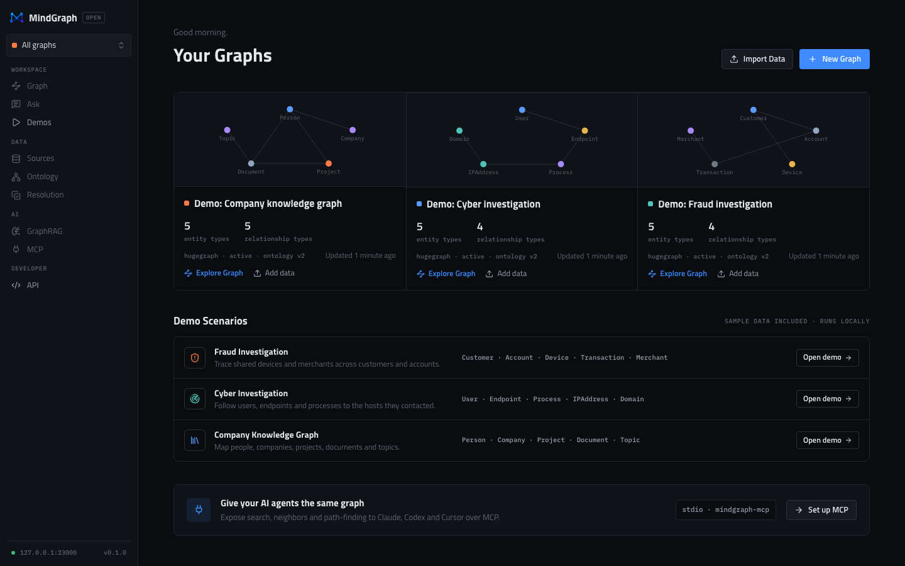

# Getting started

MindGraph-OSS runs on your machine as five containers. You need nothing but
Docker (or Podman): no Rust, Node.js, Python or `jq` on the host.



## Requirements

- **Docker** with Compose v2 (`docker compose version`), or **Podman** 5+
  with `podman compose`.
- **Memory:** the running stack uses about 1 GB (HugeGraph about 0.7 GB with
  the default 1 GB heap; PostgreSQL, Core, the web app and the AI service
  under 100 MB each, measured with the demos loaded). Give Docker Desktop or
  the Podman machine at least 4 GB.
- **Disk:** about 1.7 GB of images, plus several GB of build cache for the
  first build (Core is compiled in Rust inside Docker).
- **Browser:** a current Chrome, Edge, Firefox or Safari with WebGL enabled
  (the Graph Explorer draws with WebGL).

## Install and start

```bash
git clone https://github.com/mindwalker-ai/MindGraph-Open
cd MindGraph-Open
docker compose up --build        # Podman: podman compose up --build
```

The first build takes several minutes. On first start HugeGraph initialises
its storage, which can take a minute or two; `docker compose ps` shows each
service's health. Core reports healthy only when PostgreSQL and HugeGraph
both answer (`GET /ready`).

Then open **http://localhost:3000**.

Run it in the background with `docker compose up -d --build`; stop it with
`docker compose down` (your data stays, see
[data and backups](../operations/backup-restore.md)).

## Load a demo

```bash
make demo-fraud          # or demo-cyber, demo-knowledge
```

Each command starts the stack if needed, loads the scenario through Core's
REST API, checks the result and prints a link to the Graph Explorer. Without
`make`: `docker compose --profile demo run --rm demo fraud`. With Podman:
`make demo-fraud COMPOSE="podman compose"`. In the browser, **Demos** in the
sidebar shows which demos are loaded. The scenarios are described in
[examples/](../../examples/README.md).

## Services and ports

| Service | Role | Address |
|---|---|---|
| `web` | Next.js web app | http://localhost:3000 |
| `core` | Rust platform API (`mindgraph-core`) | http://localhost:8080 (`/health`, `/ready`, `/api/v1`) |
| `ai` | Python AI service (FastAPI) | internal only |
| `postgres` | metadata (PostgreSQL 17) | internal only |
| `hugegraph` | graph storage (Apache HugeGraph 1.7) | internal only |
| `demo` | one-shot demo loader, profile `demo` | not started by `up` |

Only `web` and `core` are published, and only on `127.0.0.1`.

## Default credentials and security

- There is **no login**: v0.1 has no users, roles or API keys. Anyone who can
  reach ports 3000 or 8080 can read and change every graph. Keep it on your
  machine and read [SECURITY.md](../../SECURITY.md) before exposing it
  anywhere.
- PostgreSQL uses `mindgraph` / `mindgraph` unless `.env` says otherwise. It
  is reachable only inside the Docker network. To use your own, copy
  `.env.example` to `.env` and set `MINDGRAPH_POSTGRES_PASSWORD` **before the
  first start**; PostgreSQL reads it only when its volume is created.
- HugeGraph runs without authentication on the internal network only.
- No model provider is configured by default, so no data leaves the machine.

## Configuration

Configuration uses environment variables (ADR-013). See
[`.env.example`](../../.env.example) for the full list.

| Variable                      | Used by   | Default (Compose)                 |
| ----------------------------- | --------- | --------------------------------- |
| `MINDGRAPH_WEB_PORT` / `MINDGRAPH_CORE_PORT` | compose | `3000` / `8080`, published on `127.0.0.1` only |
| `MINDGRAPH_POSTGRES_USER` / `_PASSWORD` / `_DB` | compose | `mindgraph` / `mindgraph` / `mindgraph` (read when the volume is first created) |
| `MINDGRAPH_HUGEGRAPH_HEAP`    | compose   | `1g` (HugeGraph Java heap) |
| `MINDGRAPH_CORE_BIND_ADDR`    | core      | `0.0.0.0:8080` in the container   |
| `MINDGRAPH_DATABASE_URL`      | core      | built from `MINDGRAPH_POSTGRES_*` (required) |
| `MINDGRAPH_DATABASE_MAX_CONNECTIONS` | core | `10` |
| `MINDGRAPH_HUGEGRAPH_URL`     | core      | `http://hugegraph:8080` (required, no credentials) |
| `MINDGRAPH_HUGEGRAPH_GRAPHSPACE` / `_GRAPH` | core | `DEFAULT` / `hugegraph`       |
| `MINDGRAPH_DATA_DIR`          | core (M4) | `/data` (volume `mindgraph-data`); `./data` outside Docker |
| `MINDGRAPH_MAX_UPLOAD_BYTES`  | core (M4) | `52428800` (50 MiB)               |
| `MINDGRAPH_MAX_INGESTION_RECORDS` | core (M4) | `100000`                      |
| `MINDGRAPH_INGESTION_BATCH_SIZE` | core (M4) | `500` (1–5000)                 |
| `MINDGRAPH_JOB_CONCURRENCY`   | core (M4) | `2` (1–16)                        |
| `MINDGRAPH_AI_URL`            | core (M5) | `http://ai:8000`; unset disables AI in core |
| `MINDGRAPH_AI_TIMEOUT_SECONDS` / `_MAX_REPAIR_ATTEMPTS` | core (M5) | `300` / `1` (0–2) |
| `MINDGRAPH_AI_JOB_CONCURRENCY` | core (M5) | `2` (1–8); AI jobs have their own workers |
| `MINDGRAPH_GRAPHRAG_TIMEOUT_SECONDS` | core (M7) | `120` (1–600): one Ask MindGraph question, end to end |
| `MINDGRAPH_GRAPHRAG_CONCURRENCY` | core (M7) | `2` (1–16) questions answered at the same time |
| `MINDGRAPH_LLM_PROVIDER`      | ai (M5)   | empty (AI disabled); `openai_compatible` |
| `MINDGRAPH_LLM_BASE_URL` / `_MODEL` | ai (M5) | empty (required with a provider) |
| `MINDGRAPH_LLM_API_KEY`       | ai (M5)   | empty (optional; never logged)    |
| `MINDGRAPH_LLM_TIMEOUT_SECONDS` / `_MAX_OUTPUT_TOKENS` / `_JSON_MODE` | ai (M5) | `60` / `4096` / `true` |
| `MINDGRAPH_LLM_MAX_RETRIES`   | ai (M5)   | `2` (0–2): retries on 429 / 5xx / dropped connections |
| `MINDGRAPH_TELEMETRY_ENABLED` | all       | `false`                           |
| `MINDGRAPH_MCP_GRAPH_ID`      | mcp (M8)  | required: the one graph the MCP server exposes |
| `MINDGRAPH_MCP_CORE_URL`      | mcp (M8)  | `http://127.0.0.1:8080` (loopback only) |
| `MINDGRAPH_MCP_TIMEOUT_SECONDS` / `_ASK_TIMEOUT_SECONDS` | mcp (M8) | `30` (1–300) / `150` (1–600) |
| `MINDGRAPH_MCP_MAX_RESULT_BYTES` | mcp (M8) | `262144` (16384–4194304) per tool result |
| `MINDGRAPH_MCP_ENABLE_ASK`    | mcp (M8)  | `false`; `true` registers `ask_graph` |

The `MINDGRAPH_MCP_*` variables configure `mindgraph-mcp`, which your MCP
client starts on your machine. They go in the client's configuration, not in
Compose.

Telemetry is off by default. MindGraph never collects graph contents,
uploaded datasets, prompts or entity data. Next.js telemetry is disabled in
the Docker image and in CI.

## Optional: an AI model

AI is optional. To get ontology suggestions in the Graph Builder and answers
from Ask MindGraph, set an OpenAI-compatible provider in `.env` (a hosted
API or a local model such as Ollama), then `docker compose up -d`. See the
[AI Graph Builder guide](../tutorials/ai-graph-builder.md) for what is sent
to the model.

## Podman notes

- Use `podman compose …` wherever this guide says `docker compose …`, and
  `COMPOSE="podman compose"` for the `make` targets.
- A model server on the host is reachable as
  `http://host.containers.internal:<port>` from the containers.
- The Podman machine needs enough memory (4 GB or more) for HugeGraph.

## Upgrading

```bash
git pull
docker compose up -d --build
```

Database migrations run automatically when Core starts. Data volumes are
kept. Before upgrading the HugeGraph image version, back up and plan a
re-import (see [data and backups](../operations/backup-restore.md)).

## Troubleshooting

| Symptom | What to do |
|---|---|
| `port is already allocated` / `address already in use` | Another program uses 3000 or 8080. Set `MINDGRAPH_WEB_PORT` / `MINDGRAPH_CORE_PORT` in `.env`, then `docker compose up -d`. |
| `core` stays `starting` or `unhealthy` | HugeGraph may still be initialising (first start). Check `docker compose ps` and `docker compose logs hugegraph core`. Core restarts until PostgreSQL and HugeGraph answer. |
| HugeGraph logs `OutOfMemoryError` | Give Docker more memory or raise `MINDGRAPH_HUGEGRAPH_HEAP` in `.env`. |
| PostgreSQL password errors after editing `.env` | The volume keeps the first password. Revert `.env`, or back up and recreate the volume ([data and backups](../operations/backup-restore.md)). |
| `make demo-*` says the existing graph does not match | An earlier load stopped part-way. Run `docker compose --profile demo run --rm demo fraud --new` for a fresh copy; the old graph is left untouched. |
| The Graph Explorer says WebGL is unavailable | Enable hardware acceleration in the browser, or try another browser. |
| The builder or Ask MindGraph says AI is not configured | Expected without a provider; every manual flow still works. Configure one as above to use AI. |

Still stuck? See [SUPPORT.md](../../SUPPORT.md).

## Uninstall

```bash
docker compose down -v     # deletes all MindGraph data: back up first if needed
docker image rm mindgraph-web mindgraph-core mindgraph-ai mindgraph-demo
```

## Next steps

- [Using the web app](../tutorials/web-app.md): build, explore, ask, MCP,
  entity resolution.
- [Building a graph through the REST API](../tutorials/rest-api.md).
- [Connect an AI agent over MCP](../mcp/README.md).
- [Known limitations](../release/KNOWN_LIMITATIONS.md) of this alpha.
